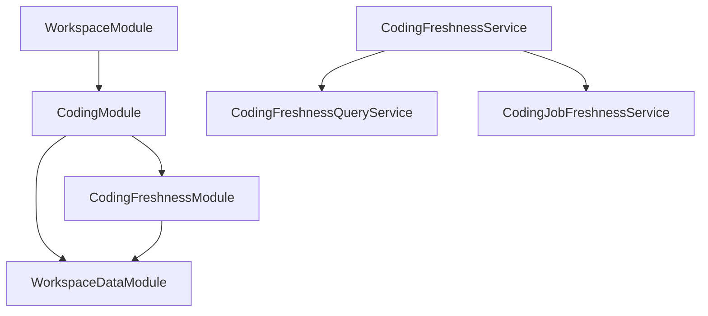

# Fachlicher Schnitt: Kodieraktualität

## Ausgangspunkt und Umfang

Grundlage ist `develop` nach dem Merge von [PR #1143](https://github.com/iqb-berlin/coding-box/pull/1143),
Commit `d28ab3485263f10a2eed6e8d49b405870980c86a` vom 1. November 2026.
Die Bestandsprüfung auf diesem Stand bestätigt:

| Bestandteil | Ausgangsgröße |
| --- | ---: |
| `WorkspaceFilesService` | 3.044 Zeilen |
| `CodingProcessService` | 2.888 Zeilen |
| `CodingFreshnessService` | 2.564 Zeilen |
| `WorkspaceModule` | 54 Provider, 38 Exporte |
| `CodingModule` | 67 Provider, 33 Exporte |

Zeilenzahlen sind Bestandsdaten. Entscheidend für diesen Schnitt sind getrennte Zuständigkeiten,
eine eigenständig ladbare Modulgrenze und die Kapselung der Implementierung.

## Umgesetzte Verantwortlichkeiten

`CodingFreshnessModule` besitzt die Kodieraktualität und exportiert ausschließlich die bestehende
`CodingFreshnessService`-Schnittstelle. Seine Provider bleiben in den bestehenden Service-Verzeichnissen.
Die Fassade hat jetzt 968 Zeilen, der Query-Eigentümer 847 und der Job-Eigentümer 754.
`CodingModule` registriert noch 66 Provider; die weiterhin breite öffentliche Kompatibilitätsschnittstelle
bleibt bis zu den nachstehenden Folgeschnitten bestehen.

| Eigentümer | Verantwortung | Abhängigkeiten innerhalb des Schnitts |
| --- | --- | --- |
| `CodingFreshnessService` | Zustandsübergänge der Unit-/Versionsaktualität bei Import, Ergebnisänderung, Schemaänderung, Reset und Kodierung; Revisionserhöhung; koordinierte Auswirkungen auf manuelle Jobs; Startblocker zusammensetzen | Query- und Job-Freshness-Service |
| `CodingFreshnessQueryService` | Zusammenfassung, gruppierte Bereiche, Löschfolgen, Revisionsprüfung, Schemazuordnung mit indexiertem und Legacy-Pfad, berücksichtigte Units und Antwortzahlen | Gemeinsame Workspace-Ausschlüsse; keine Mutations- oder Job-Provider |
| `CodingJobFreshnessService` | Job-Aktualität einschließlich Import-Nachträgen, Reset-Zählern, zurückgenommenen Ergebnisanwendungen und manueller Prüfpflicht; vollständig abgedeckte Jobs und offene Job-Blocker ermitteln | DataSource beziehungsweise übergebener Transaktionsmanager; keine Unit-Fassade |
| `coding-freshness.util.ts` | Unveränderte ID-/String-Normalisierung und Batch-Helfer | Keine DI- oder Datenbank-Abhängigkeiten |

Das Freshness-Modul hat keine Abhängigkeit auf `CodingModule`, `WorkspaceModule`, Queue-Clients oder Worker.
Die unbenutzte private Funktion `getDefaultMirCode` und ihre ausschließlich dafür vorhandene optionale
Missing-Profil-Injektion entfallen. So benötigt die neue Modulgrenze keinen Rückgriff auf das Sammelmodul.
`AutoCodingRunGuardService` bleibt als bestehender Anwendungsfall oberhalb dieser Grenze: Er verbindet
Freshness mit der effektiven Fallabdeckung aus `CodingProgressService`.

`CodingModule` importiert und reexportiert das neue Modul. Die bisherigen Importe über Coding-/Workspace-Modul
und das Service-Barrel bleiben gültig. Die beiden internen Services werden nicht als Nest-Exporte angeboten.
Die ausschließlich dort benötigte Freshness-Repository-Registrierung entfällt in den beiden Sammelmodulen.
`WorkspaceDataModule`, seine Reader-Tokens, Invalidator-Tokens, bestehende Facades und die Trennung
zwischen Queue-Clients und Workern bleiben erhalten. Es gibt keine neuen Import-Aliase und keine Änderung
an Paketmanifesten, ESM, Test-Runnern oder Validierungsbibliotheken.

## Erhaltene Verträge und Prüfgegenstände

- Alle 23 öffentlichen Methodensignaturen der bisherigen Freshness-Schnittstelle bleiben erhalten.
  Die elf Delegationen auf Query-/Job-Eigentümer übergeben sämtliche Parameter in derselben Reihenfolge.
- Ein Syntax-Token-Vergleich gegen den unveränderlichen Ausgangsstand bestätigt alle 66 weiterverwendeten
  Methodenkörper nach ausschließlicher Normalisierung der Eigentümerzugriffe. SQL, String-/Template-Literale,
  Reihenfolge und Argumente werden dabei nicht ausgeblendet. Dies ergänzt die Verhaltenstests.
- Übergebene `EntityManager` bleiben bis zu allen Lese- und Schreibzugriffen erhalten. Es gibt keine neuen
  Transaktionen, Sperren, Queue-Aufträge oder zusätzlichen Cache-Invalidierungen.
- `stale_source` wird nicht durch `review_required` oder eine Ergebnisrücknahme auf `current` herabgestuft.
  Schulungsjobs, Coding-Issue-Review-Jobs und fremde Arbeitsbereiche behalten ihre bisherigen Filter.
- Manuelle Ergebnisanwendung kann v3 veralten lassen, während weitere Jobs die Freigabe von v2 verhindern.
  Neue Antworten können Jobs auch über Variablenbündel betreffen, bevor sie als Job-Fall zugeordnet wurden.
- Zusammenfassung und Bereichsauswahl berücksichtigen dieselben Workspace-Ausschlüsse. Die revisionsgebundene
  Freigabe sowie die Bedingungen des zweiten Autocoder-Laufs bleiben bestehen.
- HTTP-Controller, DTOs, Guards, Dateiverarbeitung, GeoGebra-Verhalten und Aufrufer aus Import, Reset,
  Antwortmutation und Ergebnisanwendung werden nicht geändert.

Die AppModule-Komposition prüft echte Domain-Provider und ihre Instanzidentität, die einzige Modul-Exportschnittstelle
sowie die gemeinsamen Workspace-Ausschlüsse. Der Abhängigkeitstest umfasst das neue Modul und seine Provider.
Die neue PostgreSQL-Suite lädt `CodingFreshnessModule` eigenständig mit echten TypeORM-Repositories und echten
Workspace-Ausschlüssen. Nur die externe Cache-Anbindung ist ersetzt. Sie erzeugt eine eigene Datenbank auf einem
ausdrücklich bereitgestellten Testserver, wendet sämtliche Liquibase-SQL-Changelogs an und entfernt ausschließlich
diese Datenbank wieder. Die bestehende Integrations-Gate-Konfiguration nimmt `*.postgres.spec.ts` automatisch auf.

## Technische Validierung (Entwicklung)

Alle lokalen Prüfungen verwenden Node 24.22.1, `NX_DAEMON=false` und `NX_NO_CLOUD=true`.
Die Gesamtsuite verwendet zwei Worker mit dem vorhandenen `workerIdleMemoryLimit: '1GB'`,
einem Node-Heap-Limit von 1.536 MiB (`NODE_OPTIONS=--max-old-space-size=1536`) und einem Jest-Testzeitlimit von 30 Sekunden.
Ein vorheriger Lauf ohne Worker-Recycling musste wegen lokalem `ENOSPC` abgebrochen werden;
diese Ressourcengrenzen verändern keine Anwendungskonfiguration.
Frontend und Backend werden getrennt ausgeführt. Die Docker-Vorgaben Node 24.22.1 und npm 11.19.1 bleiben unverändert.

| Prüfung | Ergebnis |
| --- | --- |
| `NODE_OPTIONS=--max-old-space-size=3072 npx --no-install nx lint backend --skip-nx-cache` | Bestanden |
| `npx --no-install nx run backend:typecheck` | Bestanden: 0 strikte Diagnosen, 43 gültige Entity-Metadaten |
| `npx --no-install nx test backend --maxWorkers=2 --testTimeout=30000 --codeCoverage=false --silent --skip-nx-cache` | 4.158 bestanden; 141 Infrastrukturtests übersprungen; 254 Suiten bestanden |
| `POSTGRES_INTEGRATION_TESTS=true ... npx --no-install nx test backend --runInBand --codeCoverage=false --testPathPatterns=coding-freshness.postgres --skip-nx-cache` | 6 bestanden; PostgreSQL 14.24 mit vollständigem Liquibase-Schema |
| `npx --no-install nx build backend --configuration=production --skip-nx-cache` | Bestanden |
| Methodenkörper, öffentliche Signaturen, Delegationsargumente | 66 / 23 / 11 unverändert |

Für den PostgreSQL-Aufruf müssen `POSTGRES_HOST`, `POSTGRES_PORT`, `POSTGRES_USER`, `POSTGRES_PASSWORD`,
`POSTGRES_DB` und gegebenenfalls `PSQL_BIN` ausdrücklich auf einen entbehrlichen Testserver zeigen.
Der Testbenutzer benötigt `CREATE DATABASE`. Anwendungstests dürfen dafür keine Produktivinstanz verwenden.

Der bestehende Generierungscheck der Autocoder-Engine vergleicht auch eingebettete Paketpfade.
Die Validierung verwendet deshalb eine eigene lokale Kopie der Lockfile-Abhängigkeiten direkt unter
`node_modules`. Generierte Engine-Dateien und Paketversionen bleiben unverändert.

Remote-CI, Veröffentlichung, Deployment und fachliche Abnahme sind getrennte Nachweise. Dieser technische
Architekturschnitt führt keine fachliche Abnahme durch und hebt bestehende Abnahmen nicht auf.

## Konkrete Folgeschnitte

Die folgenden Schritte sind **noch nicht umgesetzt**. Jeder Schritt braucht eine eigene Prüfung seiner
Aufrufer und öffentlichen Exporte; ein vollständiger Anwendungsfall soll jeweils zusammenbleiben.

| Reihenfolge / Schnitt | Konkret zu übertragende Verantwortung | Öffentliche Grenze und wesentliche Nachweise |
| --- | --- | --- |
| 1. Workspace-Dateiimport | `uploadTestFiles`, `handleFile` mit XML/HTML/Binär-/ZIP-Pfaden, `testCenterImport`, Schemasignaturen und Freshness-Folgen aus `WorkspaceFilesService` | Bestehende Datei-Fassade erhalten; Import-Eigentümer kapselt den vollständigen gesperrten Mutationsablauf. Reader über `WorkspaceDataModule`; Queue-Produzenten über Client-Modul. Tests für Konflikte, beide Lösch-/Upload-Reihenfolgen, Schemasignaturänderungen und Invalidierung nach Erfolg beziehungsweise Teilfehlern. GeoGebra-/Resource-Package-Verarbeitung bleibt beim bestehenden Eigentümer. |
| 2. Workspace-Antwortvalidierung | Testtaker-/Gruppenvalidierung, Variablen-/Typ-/Status-/Duplikatprüfung und Entfernen ungültiger Antworten; bestehende Validation-Services darunter zusammenfassen | Eigenes Validierungsmodul mit Lese- und Lösch-Anwendungsfällen; Löschung nutzt vorhandenen Response-Mutationspfad samt Audit, Sperre und Cache-/Freshness-Folgen. Keine Rückabhängigkeit auf die vollständige Datei-Fassade. Existierende Controller-Verträge, Ausschlüsse und Validierungs-Cache-Schlüssel absichern. |
| 3. Autocoder-Auswertung | Namespace-/Aliasbildung, Solver-Referenzen, Engine-Aufruf und Erhaltung vollständiger abgeleiteter Tupel aus `CodingProcessService` | Deterministischer Auswertungs-Eigentümer ohne Repositories oder Queue; bestehende Engine- und Status-Verträge erhalten. Tests für Mehrdeutigkeit, fehlende Quellen, Summenscores, DERIVE_ERROR, bereits vollständige Tupel und identische Persistenzpläne. |
| 4. Autocoder-Batch und Persistenz | Personen-/Booklet-/Unit-/Response-Lesen und Datei-/Schema-Caches getrennt von Persistenzsitzung und Batch-Schreiben | Der existierende Prozess-Anwendungsfall koordiniert Leser, Auswertung und Persistenz. Reservierter QueryRunner, Sperrreihenfolge, Lock-Timeout-Rücksetzung und Freigabe über die gesamte Sitzung zusammenhalten. Response-Mutation bleibt zuständig für Schreibverträge, Revisionsprüfung und Invalidierung. PostgreSQL-Tests für konkurrierende Änderungen, veraltete Revisionen, Abbruch und Pool-Auslastung; echte Worker-Tests für Fortschritt und Stornierung. |
| 5. Kodierjobs | Bestehende Zugriffs-, Query-, Mutation-, Status-, Distributions-, Antwort-, Schema-, Replay- und Aggregations-Eigentümer in einem `CodingJobsModule` kapseln | `CodingJobService` und die tatsächlich benötigten schmalen Ports exportieren; interne Provider aus dem Sammelmodul entfernen. Actor-/Workspace-Rechte, Transaktion und Audit gemeinsam erhalten. Abhängigkeiten auf Response-Mutation und Peer-Aggregation vor der Modulbildung auf Zyklen prüfen. |
| 6. Schulungen und Exporte | Die bereits getrennten Schulungs-Anwendungsfälle beziehungsweise die Export-Eigentümer zu eigenständigen Modulen zusammenfassen | Öffentliche Fassaden exportieren. Schulungen dürfen über eine schmale Job-Schnittstelle Jobs erzeugen; Exporte nutzen Lese-/Replay-Schnittstellen. Missing-Profile als gemeinsam genutzte Blatt-Abhängigkeit einordnen. Streaming, Aufräumen, Missing-Scores, fachliche Referenzfilter und Ergebnisanwendung mit bestehenden Tests erhalten. |

Vor jeder Verringerung der Exporte müssen tatsächliche Controller-, Worker-, Modul- und Test-Aufrufer geprüft werden.
Das jetzige `WorkspaceModule` bleibt ein Sammelmodul; `WorkspaceFilesService` und `CodingProcessService` bleiben in diesem
PR unverändert. Auch die neue Freshness-Fassade enthält weiterhin die zusammengehörigen Zustandsübergänge und deren
Koordination. Es wird keine vollständige Zerlegung des gesamten Backends behauptet.
